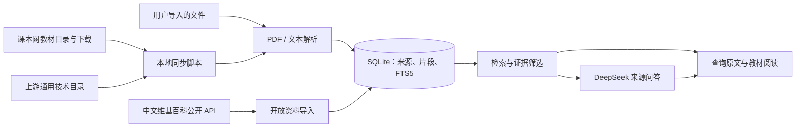

# 系统架构与资料边界

## 目标

知页 TA Agent 为初高中教学提供三个连续动作：询问知识点、定位原文、阅读对应教材。教材来自本地 PDF；网页资料单独标记来源与许可。模型回答可回到原始资料核验。

## 核心流程

1. `scripts/sync_keben.py` 按学段、学科和版本查询目录，默认选择网站标注为当前使用且修订年份不晚于本年的教材，下载到 `storage/uploads/`，记录书名、册次、出版社、来源链接。初中采用六三制，高中数学采用人教 A 版。`--book-id` 可按用户明确指定接入单本未来年份标注的教材，版本标签原样保留。课本网没有通用技术条目；`scripts/sync_general_tech.py` 从其标明的上游目录补充浙江使用的苏教版。
2. `app/ingest.py` 用 PyMuPDF 提取 PDF 页文字，每段约 650 字，保留 PDF 的 **1 起始物理页序**。这和纸质教材印刷页码可能不同。图片扫描件可阅读，但没有 OCR 时不能用于原文检索。
3. `app/db.py` 将来源和片段保存到 SQLite，用 FTS5 trigram、中文分词和文本匹配找候选片段，再按命中词、教材来源等排序。每份资料同时建立来源绑定的词项与短标题索引，用于输入补全和相近写法建议；错字候选必须实际出现在已入库资料中，界面会区分原查询与建议查询。查询结果按“来源 + PDF 页”合并，保留原文摘要和定位。学段、学科筛选由 API 执行。
4. 来源问答先检索数据库，选取至多 6 个证据片段，再通过服务端模型接口把证据整理为通顺回答。提示要求关键结论使用 `[1]` 等编号；回答下方固定列出编号对应的资料、册次和页序。无证据时不给模型构造教材答案。模型常识是独立模式，会标明未经教材核对。
5. 前端的 Chat、查询原文、阅读教材共用同一个阅读器。教材用浏览器 PDF 阅读器嵌入页面，定位到 `#page=n`；开放资料在页面内展示已导入文字，并给出原文链接。

## 数据表与接口

| 表 | 内容 |
| --- | --- |
| `catalog` | 20 个学段与学科目录位，含版本、出版社和官方说明链接。目录位不等于已下载。 |
| `sources` | 每份资料的类型、来源、版本、册次、许可和本地文件路径。 |
| `chunks` | 可检索文字、章节提示、PDF 物理页序。 |
| `chunks_fts` | 片段全文索引。 |
| `search_terms` | 从已入库资料生成的词项与短标题，供补全和错别字建议使用。 |

| 接口 | 用途 |
| --- | --- |
| `GET /api/status`、`/api/catalog`、`/api/sources` | 资料覆盖和列表。 |
| `POST /api/search` | 带学段、学科筛选的原文检索。 |
| `GET /api/suggest` | 按当前学段和学科提供补全与相近写法。 |
| `POST /api/chat` | `grounded` 来源问答或 `general` 模型常识。 |
| `GET /api/sources/{id}/content`、`/file` | 正文或原版 PDF 阅读。 |
| `GET /api/web/search`、`POST /api/web/import` | 查找并导入开放网络资料。 |

## 来源与部署

教材 PDF 和数据库仅保存在本机 `storage/`，不进入 Git；同步脚本只提供获取过程，不授予教材再分发权。[课本网的说明](https://keben.app/disclaimer)将资料用途限定为个人学习研究，并确认出版社版权。课堂或比赛演示时需遵循相应使用条件；若公开部署，需另行取得可展示教材的授权。

当前服务只监听 `127.0.0.1`。DeepSeek 密钥位于未提交的 `.env`，由服务端读取。公开或多人部署前，需要加入身份验证、访问控制、请求限额、密钥管理以及资料授权方案。

## 已知限制与下一步

- PDF 物理页序与书页印刷编号不同，演示时以阅读器页序为准；后续可增加印刷页码映射。
- 扫描版 PDF 尚无 OCR 和文字定位。OCR 后需标记置信度并保留原图供核验。
- 当前检索为词项匹配，无向量语义检索；跨表述问句可能漏召回。可在已有来源标记和引用机制上增加向量召回与重排。
- 版本与册次依赖来源目录元数据；上线前需按出版社目录逐册核对。
