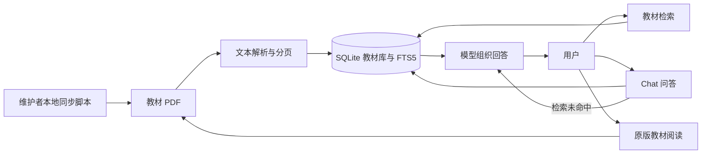

# 系统架构

教材库只存储教材。同步脚本从既定来源下载 PDF，建立书名、学段、学科、册次、原始 PDF 页序和分块索引。普通用户只有查询与阅读权限；Web API 没有上传、删除或网页导入端点。

检索结合中文分词、FTS5、文本匹配、问题意图和学科相关性排序。定义类问题会优先定位教材中的定义段落。Chat 优先使用检索到的教材片段生成答案，引用标记指向具体 PDF 页；无合适教材匹配时改用模型回答，在答案下方单独提示未命中，不伪造引用。

前端使用本地 KaTeX 渲染数学公式，PDF 阅读在独立全屏界面打开。返回按钮会回到原页面。API Key 只在服务端环境变量中读取。

主要只读 API：`GET /api/status`、`GET /api/catalog`、`GET /api/sources`、`GET /api/sources/{id}/content`、`GET /api/sources/{id}/file`、`POST /api/search`、`GET /api/suggest`、`POST /api/chat`。后两个 POST 是查询请求，不修改知识库。
